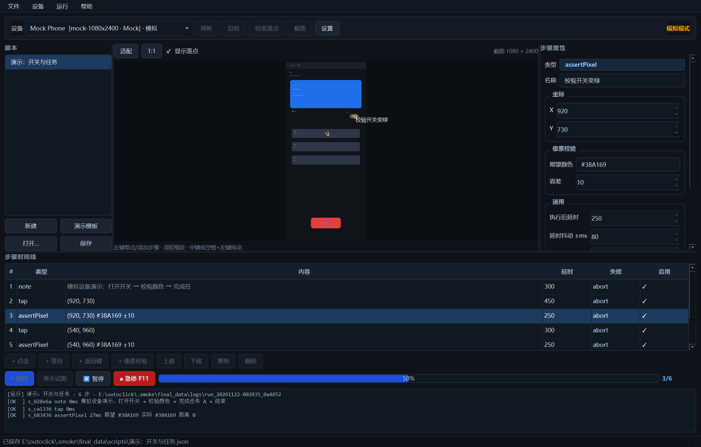

# outoclick · 安卓自动点击器（MVP）

用 Windows 电脑通过 ADB 驱动一台 Android 设备，按**固定坐标**回放预设的点击序列。手机端不装 App、不开无障碍、不 Root，只开 USB 调试。

> 当前是 MVP：核心链路（截图拾取 → 脚本 → 校验 → 执行 → 日志）已跑通，并内置一台模拟设备，没手机也能完整体验。

## 截图



## 已实现（MVP 范围）

- 设备发现、授权状态提示、无线调试连接（人工调试用）
- 注入能力自检（`INJECT_EVENTS` / usage 探测）、屏幕唤醒与锁屏检查
- 设备档案：`wm size` + `screencap` 尺寸 + 宽高比校验，不一致**拒绝运行**
- 截图 / 缩放 / 平移 / 1px 微调 / 步骤落点叠加
- 动作：`tap`、`longPress`、`swipe`、`wait`、`key`、`text`（ASCII）、`launchApp`、`stopApp`、`screenshot`、`assertPixel`、`note`、`group`（循环）
- 逐步延时 + 随机抖动 + 点击随机偏移 + 失败策略（abort/retry/continue/pause）
- 暂停 / 继续 / 急停（全局热键，F12 被占用时自动降级到 F11/F10/F9/F8）
- 置顶 HUD + 托盘级控制（PC 侧的「悬浮球」替代）
- 运行日志 JSONL、失败截图、运行摘要；保留最近 50 次
- 脚本 JSON 存取、导入导出、单步试跑、从选中步骤运行
- 单实例：GUI 常驻时 CLI 通过本地回环 socket 投递任务并取回结果
- 模拟设备：完整可交互的假屏幕，支持开关/任务/完成按钮与像素校验

## 暂未实现（按 SPEC v0.3 的后续里程碑）

- 图像模板匹配 / OCR / 控件定位（v2）
- 多指手势、贝塞尔曲线滑动（需 scrcpy 控制通道或 minitouch）
- `getevent` 录制、找色、`waitStable`、百分比坐标的可视化编辑（v1.2）
- 计划任务 UI（现在可用 `schtasks`，但必须「仅在用户登录时运行」）
- 打包 exe（现在直接用 Python 运行）

## 环境

- Windows 10/11 x64
- Python 3.13（3.10+ 应该也可以）
- Android Platform-Tools（`adb`）——**未内置**，需要单独下载
- 手机：Android 7.0+，开启「开发者选项 → USB 调试」
  - 小米/红米：还必须开启「USB 调试（安全设置）」，否则 `input` 会抛 `INJECT_EVENTS`

## 快速开始（无需手机）

```powershell
cd E:\outoclick
python -m pip install -r requirements.txt
python -m app.main
```

启动后设备下拉框里会有 **Mock Phone**。点「演示模板」会自动生成一条脚本：

1. 打开 AUTO MODE 开关
2. `assertPixel` 校验开关变绿
3. 完成任务 A 并再次校验
4. 点击 FINISH

点「▶ 运行」即可看到 HUD、进度、逐步日志和运行摘要。

命令行等价：

```powershell
python -m app.cli --make-demo
python -m app.cli --mock --run "$env:USERPROFILE\Documents\AutoClickAndroid\scripts\演示：开关与任务.json"
```

## 连接真机

1. 下载并解压 [Android Platform-Tools](https://developer.android.com/tools/releases/platform-tools)。
2. 手机开启 USB 调试，插线；手机上点「允许 USB 调试」。
3. 启动 outoclick → 「设置」里选择 `adb.exe`，或直接点「刷新」自动查找。
4. 选择设备 → 「自检」：
   - 注入能力 OK
   - `wm size` 与截图尺寸一致
   - 屏幕已唤醒、未锁屏
5. 「截图」→ 在画布上点击目标位置即可新增点击步骤。

> 如果自检报告 `INJECT_EVENTS`：按提示去开发者选项打开「USB 调试（安全设置）」。部分小米机型需要登录账号、插 SIM 并重启，且存在账号级开启配额。

## 界面工作流

| 动作 | 说明 |
|---|---|
| 画布单击 | 新增一个 `tap` 步骤（坐标 = 当前设备像素） |
| 选中步骤 → 「取点」 | 重新指定目标坐标；`swipe` 需要点起点、再点终点 |
| 选中步骤 | 右侧编辑延时、抖动、偏移、失败策略、颜色校验等 |
| 时间线 | 上移/下移/复制/删除；双击不做编辑，统一在右侧表单改 |
| 单步试跑 | 只执行当前选中的顶层步骤 |
| ▶ 运行 | 先保存脚本，再做完整校验，最后顺序执行 |
| F12（或实际热键） | 任意时刻急停；最多等待 1 个在途动作返回 |
| 暂停 | 不再下发新指令；延时等待会被冻结 |

## 命令行

```powershell
python -m app.cli --list-devices          # 列出设备（含模拟设备）
python -m app.cli --selftest              # 对当前/指定设备做自检
python -m app.cli --selftest --device emulator-5554
python -m app.cli --make-demo             # 生成模拟演示脚本
python -m app.cli --mock --run <脚本>      # 无界面运行
python -m app.cli --status                # 查看 GUI/运行状态
python -m app.cli --stop                  # 请求 GUI 急停
```

- GUI 没打开时：`--run` 直接在当前进程执行，日志照常落盘。
- GUI 已打开时：CLI 通过 `127.0.0.1:47821` 投递任务，并轮询到运行结束返回结果码。
- `--run` 支持脚本路径、文件名或脚本 id 的模糊匹配（按文件名）。

## 数据目录

`%USERPROFILE%\Documents\AutoClickAndroid\`

```
profiles.json          # 设备档案（serial / 分辨率 / 密度 / 校准状态）
scripts\<id>.json      # 用户脚本
logs\<runId>\log.jsonl # 逐步 JSONL 日志
logs\<runId>\summary.md
logs\<runId>\fail_*.png
settings.json          # adb 路径、上次设备、窗口大小
```

调试时可覆盖：`$env:OUTOCLICK_DATA='E:\tmp\outoclick-data'`。

## 安全设计（MVP 已生效）

1. **三向校验**：`wm size`、截图尺寸、宽高比任一不符 → 拒绝运行（不做自动裁剪/猜测）。
2. **注入自检**：开跑前确认 `input tap` 可用；被 ROM 拒绝时给出明确指引。
3. **屏幕状态检查**：熄屏/锁屏时注入会被系统吞掉且返回 0，因此开跑前强制检查。
4. **到位判定**：`input tap` 本身没有反馈，关键节点请配 `assertPixel`；这也是唯一的「点到了」证据。
5. **急停粒度**：一次 adb 调用只做一个动作，急停最多等待 1 个在途动作；停止后不做任何补偿点击。
6. **无批处理**：MVP 故意不做多动作批处理，避免「急停要等整批跑完」。
7. **失败留证**：失败步骤自动截图，日志记录期望/实际颜色与耗时。

## 开发与测试

```powershell
python -m pip install -r requirements.txt -r requirements-dev.txt
python -m pytest -q
```

当前 29 个测试，覆盖：

- 坐标缩放、比例失真、越界（永不裁剪）、百分比换算
- 脚本校验（越界、重复 id、非 ASCII、分组展开、版本兼容）
- 模拟设备截图/点击/开关状态
- 档案一致性与可逆控件校准
- 执行引擎：完整跑通、急停、失败继续、坐标非法时零点击

## 目录结构

```
app/
├─ main.py              # GUI 入口（含深色 QSS）
├─ cli.py               # 命令行入口
├─ core/
│  ├─ transport.py      # BaseTransport / AdbTransport / MockTransport
│  ├─ coords.py         # 坐标换算（拒绝越界，不裁剪）
│  ├─ profile.py        # 档案、三向校验、可逆控件校准
│  ├─ script_model.py   # 脚本模型、校验、展开、模板
│  ├─ engine.py         # 状态机、执行、暂停/急停、失败策略
│  ├─ logger.py         # JSONL 日志、摘要、截图、保留策略
│  ├─ ipc.py            # 单实例 + CLI 投递（127.0.0.1:47821）
│  └─ paths.py / config.py / errors.py / imageops.py
├─ ui/
│  ├─ main_window.py    # 三栏主界面 + 运行面板
│  ├─ canvas_picker.py  # 截图缩放/平移/取点/落点标记
│  ├─ hud.py            # 置顶控制条
│  └─ hotkey.py         # Win32 RegisterHotKey（含降级）
└─ resources/
```

## 已知限制

- 画布坐标按 **设备物理像素** 存储；换分辨率会按比例换算，但宽高比差异 >2% 直接拒绝。
- 只支持竖屏（rotation 0）；横屏/折叠屏/多屏需要 v1.2 的旋转换算。
- 百分比坐标脚本可以运行，但 MVP 界面只能编辑绝对值（JSON 里可改）。
- `text` 仅 ASCII；中文需要 ADBKeyBoard（未做）。
- 全局热键默认 F12；本机被其他程序占用时会自动改用 F11，界面和日志会显示实际键位。
- 计划任务必须勾选「仅在用户登录时运行」，否则 Session 0 里没有桌面，任务会「成功但什么都没做」。
- `FLAG_SECURE` 页面（银行/支付）截图全黑，拾取和 `assertPixel` 都不可用。

## 下一步

1. 真机跑一遍 SPEC 附录 C 的 Spike（注入、Override 尺寸、熄屏行为）。
2. v1.1：scrcpy 只读投屏（`--no-control`）、计划任务注册、快捷连点。
3. v1.2：`getevent` 录制、找色、`waitStable`、旋转换算。
4. v2：OpenCV 找图 + `uiautomator dump` 控件定位。
