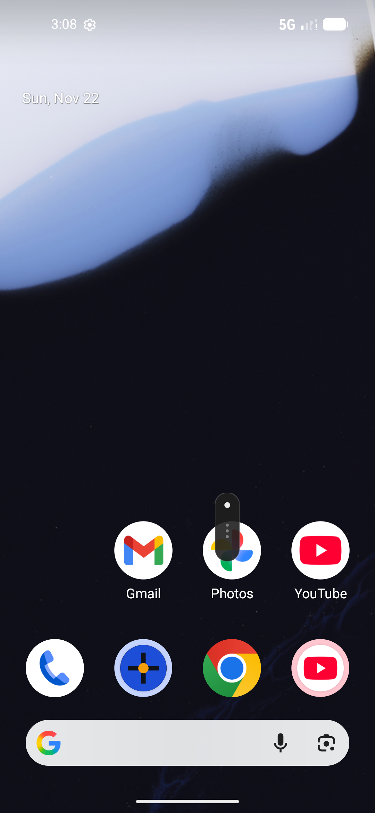
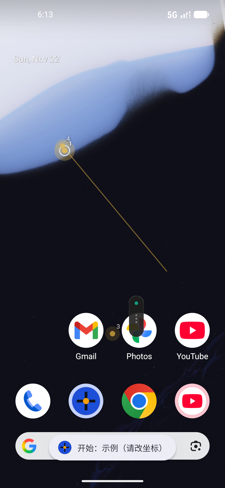
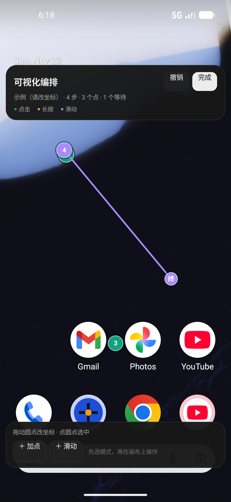

# outoclick · 安卓自动点击器

独立 Android App：在手机上预设固定坐标的点击序列，由无障碍服务回放。
**不需要电脑、不需要 ADB、不需要 Root。**

> 当前版本：MVP `0.4.0`（debug APK），已在 Pixel 5 模拟器 **Android 17 / API 37** 实测：悬浮条、侧滑抽屉、方案保存/另存为/退出、回放落点、随机节奏、画布画滑动、分辨率缩放均通过。
>
> **下载 APK**：[outoclick-0.4.0-debug.apk](https://github.com/wmoonlq/autoclick/releases/download/v0.4.0/outoclick-0.4.0-debug.apk) · [Release 说明](https://github.com/wmoonlq/autoclick/releases/tag/v0.4.0) · [迭代记录](CHANGELOG.md)

## 截图

| 主界面 | 悬浮条 | 侧滑抽屉 | 回放落点 | 可视化编排 |
|---|---|---|---|---|
|  |  |  |  |  |

## 能做什么

- **iQOO 式游戏助手交互**：贴边半透明悬浮条，单击从侧边滑出工具抽屉，不挡画面、闲置自动淡出
- **侧滑抽屉**：方案切换、开始/暂停/停止、可视化编排、准星取点、脚本列表、隐藏，一屏直达
- **方案管理**：保存 / 另存为 / 退出当前方案；多套方案一键切换
- **回放落点预览**：运行时黄色光点 + 编号叠加在画面上，当前步骤高亮，可一键显隐
- **坐标归一化**：记录方案创建时的分辨率，换机 / 改分辨率按比例缩放
- **随机节奏**：每步延时 ±120ms、坐标 ±6px（可关、可自定义），仅做通用抖动
- **全屏可视化编排**：拖动圆点改坐标；「＋ 加点」点空白新增；「＋ 滑动」直接画起点→终点；支持撤销、改类型、删除
- **悬浮准星取点**：拖动十字准星到按钮上，点「记录」生成坐标
- **自由摆放 + 贴边**：悬浮条可拖到任意位置，靠近左右边缘自动吸附贴边，位置会记住
- **隐藏与恢复**：隐藏悬浮条后服务继续运行，从通知栏一键恢复
- **脚本编排**：点击 / 长按 / 滑动 / 等待；每步可设延时、启用状态；脚本可循环 N 次
- **本机存储**：脚本是纯 JSON，支持复制、删除、剪贴板导入导出
- **GPT 风格深色 UI**：中性灰黑、白色主按钮、细边框、大圆角、少而准的绿色点缀
- **前台服务**：运行状态常驻通知，避免被系统随手回收

## 快速开始

### 直接安装 APK

```powershell
adb install -r android\app\build\outputs\apk\debug\app-debug.apk
```

或者把 APK 拷到手机上手动安装（需要允许「安装未知来源应用」）。

### 从源码构建

前置：

- JDK 17 或 21
- Android SDK：`platforms;android-36`、`build-tools;35.0.0+`
- Gradle 8.13（工程没有内置 wrapper）

```powershell
$env:JAVA_HOME='D:\JDKSS\Jdks\jdk-21.0.12.1+1'
$env:ANDROID_HOME='E:\AndroidSdk'
cd android
E:\gradle\gradle-8.13\bin\gradle.bat assembleDebug
```

`android/local.properties` 里的 `sdk.dir` 指向你的 SDK 目录（该文件已被 gitignore）。

产物：

```
android/app/build/outputs/apk/debug/app-debug.apk
```

## 使用流程

1. 打开 App，在「准备」卡片里依次开启：
   - **无障碍服务**：设置 → 无障碍 → 已下载的应用 → outoclick 点击执行器
   - **悬浮窗**：允许显示在其他应用上层
   - **通知**（Android 13+）：前台服务状态，也是隐藏悬浮条后的恢复入口
2. 在「脚本」里新建，或直接用自带的示例脚本。
3. 点「启动悬浮条」，App 退到后台，屏幕边缘出现一条细长的半透明悬浮条：
   - 拖到任意位置；靠近左右边缘会自动贴边
   - 闲置约 2.6 秒自动变淡，摸一下恢复
4. **单击悬浮条**，从最近的屏幕侧边滑出抽屉（点空白处或 × 关闭）：
   - 顶部是当前方案 + 方案标签，点一下切换脚本
   - 白色大按钮：开始 / 继续 / 暂停；右侧红色「停止」
   - 工具格：可视化编排、准星取点、脚本列表、隐藏悬浮条
   - 选项：回放时显示落点 / 随机节奏
   - 方案：保存 / 另存为 / 退出
   - 开始 / 暂停后抽屉自动收起，不挡目标 App
5. 可视化编排：
   - 每个点位显示为带编号的圆点，**直接拖动**到目标位置，松手即保存
   - 点「＋ 加点」进入加点模式，再点屏幕空白处新增一个点击点位；选中后可「变长按 / 删除」
   - 点「＋ 滑动」，按住起点拖到终点松手，直接生成滑动步骤
   - 「撤销」回退上一步，「完成」退出并恢复悬浮条
6. 准星取点：拖准星到目标位置，底部工具条点「记录点击」；滑动先点「起点」再移到终点点「终点」。
7. 回放落点：开启后运行时会在画面上显示黄色光点 + 编号，当前步骤白色高亮；停止后自动消失。
8. 回到 App 可以微调坐标、时长、延时、循环次数和随机节奏（±ms / ±px）。

## 脚本格式

每台手机本地保存为 `files/scripts/<id>.json`，也可以从 App 导出到剪贴板：

```json
{
  "schemaVersion": 2,
  "id": "a1b2c3d4e5",
  "name": "每日签到",
  "repeat": 1,
  "baseWidth": 1080,
  "baseHeight": 2340,
  "jitterMs": 120,
  "jitterPx": 6,
  "steps": [
    { "type": "TAP", "x": 540, "y": 1200, "durationMs": 60, "delayAfterMs": 800, "enabled": true },
    { "type": "LONG_PRESS", "x": 300, "y": 900, "durationMs": 800, "delayAfterMs": 300, "enabled": true },
    { "type": "SWIPE", "x": 540, "y": 1800, "x2": 540, "y2": 900, "durationMs": 300, "delayAfterMs": 300, "enabled": true },
    { "type": "WAIT", "durationMs": 1500, "delayAfterMs": 0, "enabled": true }
  ]
}
```

- `x / y / x2 / y2` 是**方案基准分辨率**下的物理像素；回放时按 `当前屏幕 / base` 缩放。
- `jitterMs` / `jitterPx` 为 0 表示关闭随机节奏；否则每步延时和坐标在该范围内随机抖动。
- 旧版（schemaVersion 1）没有 base 字段，首次保存时会以当前屏幕补上。

## 权限与安全

| 权限 | 用途 | 是否读取内容 |
|---|---|---|
| 无障碍服务 | 通过 `dispatchGesture` 注入点击/滑动 | 否，`canRetrieveWindowContent=false` |
| 悬浮窗 | 悬浮球 + 准星取点 | 否 |
| 通知 | 前台服务状态 | 否 |

- 所有脚本与运行状态只存在本机，App 不联网。
- 无障碍服务只做手势注入，不读取屏幕内容，不上传任何数据。
- 停止是「不再派发下一步」，已经在执行的一次手势（通常 60–800ms）会自然结束，不会补点。

## 原理

```
MainActivity        脚本列表 / 步骤编辑 / 权限引导
OverlayService      悬浮条、侧滑抽屉、准星、前台通知
SidePanel           侧滑抽屉 / 方案切换 / 工具格 / 开始停止
HandleView          贴边悬浮条（状态点 + grip）
VisualEditor        全屏可视化编排（拖点 / 加点模式 / 撤销）
ClickAccessibilityService   dispatchGesture(TAP / LONG_PRESS / SWIPE)
Runner              协程顺序执行，循环、延时、暂停/停止
ScriptStore         filesDir/scripts/*.json
```

- 点击：`GestureDescription.StrokeDescription(path, 0, 60ms)`
- 长按：同点，时长 800ms
- 滑动：`moveTo → lineTo`，默认 300ms
- 等待：`delay(ms)`，可被暂停/停止打断
- 运行循环：`delayAfterMs` 在每步之后执行

## 已知限制

- **固定坐标**：目标 App 改版后需要重新取点；分辨率变化已支持按比例缩放。
- **仅竖屏**：暂不处理旋转后的坐标换算。
- **无图像识别**：不会「找按钮」，只按坐标点。
- **不支持真实录制**：Android 不允许 App 静默读取其他 App 的触控；用可视化加点或 PC + ADB 录制替代。
- **不支持自动跳过弹窗**：游戏引擎画面无法通过无障碍树识别「确认/关闭」；普通 App 的节点识别留待后续。
- **无连接超时重连**：本地无障碍服务没有远端连接，不需要倒计时重试。
- **随机节奏不是防检测**：只是通用延时/坐标抖动，不保证规避平台检测；在线游戏有封号风险。
- **息屏/锁屏**：无障碍手势在锁屏状态下无法操作目标 App。
- **系统安全界面**：部分系统弹窗、安全键盘、支付类页面可能拒绝注入。
- **厂商保活**：MIUI / HyperOS / ColorOS 等可能杀后台，建议把 App 加入电池白名单。
- **反作弊风险**：游戏/平台可能检测自动化操作，账号风险由使用者承担。

## 项目结构

```
android/                    独立 Android 工程（主交付物）
  app/src/main/java/com/outoclick/app/
    MainActivity.kt         脚本列表 / 步骤编辑 / 权限引导
    OverlayService.kt       悬浮条、侧滑抽屉、准星、通知、编排入口
    SidePanel.kt            iQOO 式侧滑抽屉（方案 / 运行 / 工具格 / 选项）
    HandleView.kt           贴边悬浮条（状态点 + grip 绘制）
    PointPreview.kt         回放落点黄色光点 + 编号
    ToggleChip.kt           GPT 风格开/关胶囊
    VisualEditor.kt         全屏可视化编排（拖点 / 加点 / 画滑动 / 撤销）
    ClickAccessibilityService.kt  手势注入
    Runner.kt               顺序执行 / 循环 / 暂停停止
    Model.kt / Store.kt     脚本模型与本机 JSON 存储
app/                        早期的 Windows + ADB 原型（Python，非主交付物）
docs/PC-PROTOTYPE.md        PC 原型说明
docs/FEASIBILITY-REVIEW.md  规格可行性评审
SPEC.md                     PC 原型规格（v0.4），安卓版的约束可参考
```

## 开发

```powershell
# 只编译，不安装
cd android
E:\gradle\gradle-8.13\bin\gradle.bat assembleDebug

# 安装并看日志
adb install -r app\build\outputs\apk\debug\app-debug.apk
adb logcat -s outoclick AndroidRuntime
```

调试无障碍服务时，改完代码重新安装后需要在系统设置里**关闭再打开**一次无障碍服务，服务才会绑定新版本。

## 故障排查

| 现象 | 处理 |
|---|---|
| 悬浮条不出现 | 确认「显示在其他应用上层」已允许；在 App 里重新点「启动悬浮条」；若曾点过「隐藏」，从通知栏点「显示悬浮条」 |
| 悬浮条太淡看不清 | 闲置约 2.6 秒会淡到 40%，摸一下恢复；这是刻意做的防遮挡 |
| 点了悬浮条没反应 | 悬浮条很窄（26dp），点在胶囊范围内；开抽屉后点屏幕空白或 × 关闭 |
| 编排里看不到点 | 等待步骤（WAIT）没有坐标，不会显示在画布上，回脚本页编辑 |
| 编排时点空白没加点 | 新版需要先点「＋ 加点」进入加点模式，再点空白，防止误触 |
| 点「开始」没反应 | 无障碍服务未开启，或服务被系统杀掉；重新进设置开关一次 |
| 点击位置偏移 | 坐标是屏幕物理像素；用准星重新取点，注意状态栏/手势导航区域 |
| 运行一会儿就停 | 厂商省电策略杀掉服务；加入电池白名单，保持前台通知 |
| 抽屉挡住目标 | 点抽屉外空白关闭；或把悬浮条拖到另一侧再打开 |
| 安装失败 | 确认允许未知来源；或 `adb install -r` 覆盖安装 |
| 无障碍开关是灰的 / 提示受限 | Android 13+ 侧载应用需在「应用信息 → outoclick → 允许受限设置」后再开启无障碍 |

## 下一步

- 无障碍节点识别（仅普通 App：自动关闭确认框，游戏内不可用）
- 方案文件导入导出（SAF，不再只走剪贴板）
- 脚本分组循环 / 条件步骤
- PC + ADB 录制模式（真录触摸轨迹）
- 横屏与旋转坐标换算
- 运行日志与失败截图（需要 MediaProjection）
- 计划任务（每天定时执行）
