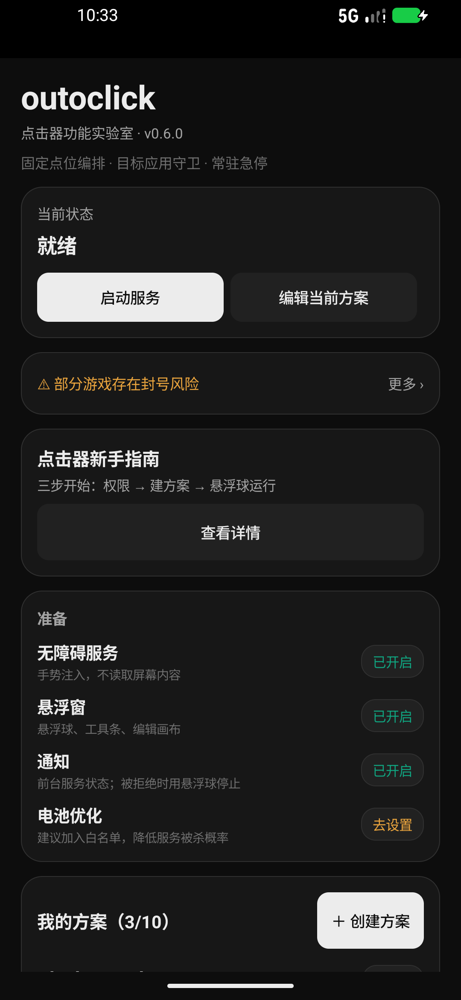
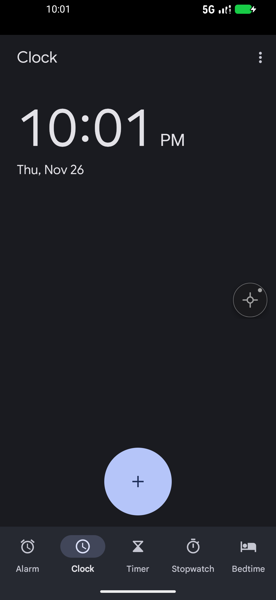
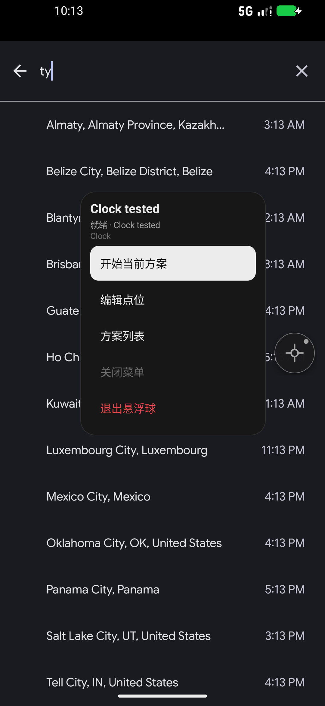
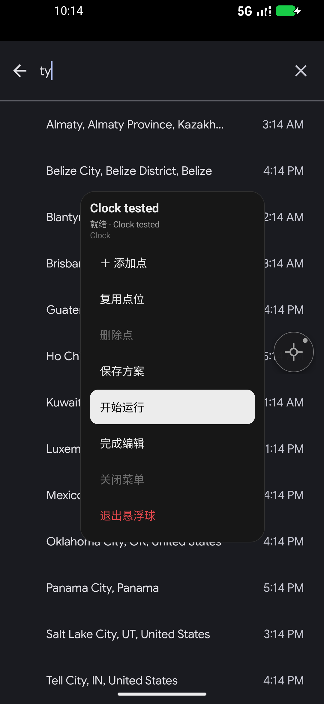
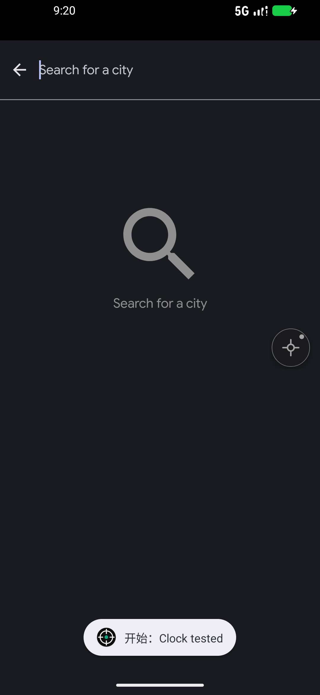
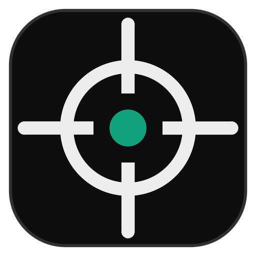

# outoclick · 安卓自动点击器

独立 Android App：把固定点位编排成方案，通过无障碍服务回放。
**不需要电脑、不需要 ADB、不需要 Root。**

> 当前版本：**v0.6.0（悬浮球交互重构，debug APK）**，minSdk 24 / targetSdk 34。
> **下载 APK**：[outoclick-0.6.0-debug.apk](releases/outoclick-0.6.0-debug.apk) · [SHA256](releases/outoclick-0.6.0-debug.apk.sha256)
> 已在 Pixel 5 模拟器 **Android 17 / API 37** 完成核心链路验证：目标应用绑定、按钮库/复用、方案编排、SQLite 落库、运行会话、暂停/继续/停止、操作边栏、force-stop 启动对账。
> **0.6.0 交互**：悬浮球只在绑定的目标应用前台显示；主页面/桌面不显示，避免挡触摸。停止状态单击开始、长按打开操作边栏；运行中单击暂停、长按停止；暂停单击继续、长按停止。编辑统一收进长按边栏，不再有独立顶部工具条。
> **0.5.1 修复**：运行前等待编辑层/菜单从 WindowManager 移除，避免第一下点击落到自己的 overlay 上；已用 Clock `+` 按钮实测打开搜索页。
>
> 需求基线：`产品功能示意图/数据实体建模.md`（v4）+ `产品功能示意图/测试用例-v1.md`。
> 完整 v1 用例还需要配套「探针 App」逐条回归，当前完成的是核心闭环与主要 P0。

## 截图

| 主页面（无悬浮球） | 目标应用悬浮球 | 操作边栏 | 编辑边栏 | 真实点击 |
|---|---|---|---|---|
|  |  |  |  |  |

应用图标：



## 能做什么

- **目标应用绑定**：创建方案后先从已安装应用里选择目标应用；绑定的时候记录屏幕方向和分辨率。悬浮球只在目标应用前台出现。
- **按钮库 + 方案编排**：点位是独立的按钮，方案只负责“先点谁、隔多久、是否启用”。支持「复用点位」，同一个按钮可以被多个步骤/方案引用，改位置会同步所有引用。
- **完整时间参数**：点击次数 1–50、点击间隔 0–60000ms、点击时长 10–500ms、点位间隔 0–60000ms、循环 1–99 轮。
- **运行会话**：每次运行有 `RunSession`、深拷贝快照、状态机和进度；运行历史落 SQLite。
- **目标应用守卫**：启动前校验前台包名、方向、分辨率；运行中切到桌面/微信等会暂停；系统设置、安装器、权限控制器、SystemUI 出现会直接停止。
- **悬浮球控制**：
  - 停止：单击开始；长按打开操作边栏（编辑点位 / 方案列表 / 退出）
  - 运行中：单击暂停；长按停止
  - 暂停：单击继续；长按停止
  - 输入法弹出不会误隐藏悬浮球，也不会误暂停
- **统一操作边栏**：编辑不再有独立顶部工具条；长按悬浮球打开边栏，编辑模式里完成添加点 / 复用点位 / 删除点 / 保存方案 / 开始运行 / 完成编辑。
- **主页面不挡触摸**：主页面、桌面、其他 App 上不显示任何 overlay；切回目标应用才显示悬浮球。
- **通知栏控制**：运行中提供「暂停 / 停止」，暂停时提供「继续 / 停止」。
- **随机化**：固定 ±5ms / ±3px，引擎默认开启，不暴露 UI（按测试 M6）。
- **本机 SQLite**：`apps / buttons / plans / plan_steps / sessions / settings` 六张表；保留最近 50 条会话。
- **旧数据迁移**：首次启动把 v0.4 的 `files/scripts/*.json` 里 TAP / LONG_PRESS 迁移成按钮+方案；SWIPE / WAIT 跳过。
- **Google / ChatGPT 风格 UI**：中性灰黑、白色主按钮、少量绿色状态强调；应用图标同步换成准星 + 绿点。

## 快速开始

### 直接安装 APK

```powershell
adb install -r android\app\build\outputs\apk\debug\app-debug.apk
```

### 从源码构建

前置：

- JDK 17 或 21
- Android SDK：`platforms;android-36`、`build-tools;35.0.0+`
- Gradle 8.13（工程没有内置 wrapper）

```powershell
$env:JAVA_HOME='D:\JDKSS\Jdks\jdk-21.0.12.1+1'
$env:ANDROID_HOME='E:\AndroidSdk'
cd android
E:\gradle\gradle-8.13\bin\gradle.bat assembleDebug
```

产物：

```
android/app/build/outputs/apk/debug/app-debug.apk
```

## 使用流程

1. 打开 App，在「准备」卡片里开启：
   - **无障碍服务**：设置 → 无障碍 → 已下载的应用 → outoclick 点击执行器
   - **悬浮窗**：允许显示在其他应用上层
   - **通知**（Android 13+）：前台服务状态，也是通知栏停止入口
   - **电池优化**：建议加入白名单
2. 点「＋ 创建方案」；如果还没绑定目标应用，先从已安装应用列表里选择。绑定后服务启动，**切到目标应用才会出现悬浮球**。
3. 悬浮球交互（只有目标应用前台才显示）：
   - **停止状态**：单击开始当前方案；长按打开操作边栏
   - **运行中**：单击暂停；长按停止（不打开编辑边栏）
   - **暂停**：单击继续；长按停止
4. 长按打开操作边栏：
   - **开始当前方案 / 暂停 / 继续**
   - **停止运行**
   - **编辑点位**
   - **方案列表**
   - **退出悬浮球**
5. 进入「编辑点位」后，边栏切换成编辑操作：
   - **＋ 添加点**：在画布中央生成点位，再拖动到目标位置
   - **复用点位**：引用按钮库里已有的按钮（共享坐标）
   - **删除点**：删除当前选中点位；被其他方案引用时会提示并支持级联删除
   - **保存方案**：填写方案名、循环轮次，显示预估总时长
   - **开始运行**
   - **完成编辑**
6. 点画布上的编号圆点打开「单点设置」：
   - 点击次数、点击间隔、点击时长、点位间隔
   - 右上角「删除」彻底删除按钮
7. 运行中/暂停时通知栏也有「暂停 / 继续 / 停止」。
8. 离开目标应用、回到桌面或打开 outoclick 主页面：悬浮球和边栏自动隐藏，不挡触摸；切回目标应用后重新显示。
9. 进程被杀后重新打开 App，旧的 `RUNNING/PAUSED` 会话会被标记为 `STOPPED(KILLED)`，不会残留「卡死会话」。

## 数据模型（SQLite）

数据库：`/data/data/com.outoclick.app/databases/outoclick.db`

| 表 | 作用 |
|---|---|
| `apps` | 目标应用：`package_name / app_label / bound_rotation / bound_display_w/h` |
| `buttons` | 按钮库：归一化 `anchor_x/y` + 热区 `width/height` + 点击次数/间隔/时长 |
| `plans` | 方案：目标应用、名称、状态、循环轮次、随机化参数、版本 |
| `plan_steps` | 编排：`plan_id / button_id / seq / enabled / point_gap_ms` |
| `sessions` | 运行会话：状态、暂停/停止原因、进度、快照 JSON、错误码、耗时 |
| `settings` | 当前方案、数据结构版本 |

## 时间轴语义

```
单步动作时长 = click_count × press_ms + (click_count − 1) × click_gap_ms
单轮时长     = Σ(enabled 步骤动作时长 + point_gap_ms)
预估总时长   = loop_count × 单轮时长 − 最后一个 point_gap_ms
```

- `click_gap_ms`：上一次抬起 → 下一次按下，不是“按下→按下”的周期。
- `point_gap_ms`：本步最后一次抬起 → 下一步第一次按下；**跨轮同样生效**。
- 最后一轮的最后一步不执行 `point_gap`。
- 例：3 个点、各 1 次、时长 75ms、点位间隔 1000ms、10 轮 = `10 × 3 × (75+1000) − 1000 = 31250ms ≈ 31.3s`。

## 权限与安全

| 权限 | 用途 | 是否读取内容 |
|---|---|---|
| 无障碍服务 | `dispatchGesture` 注入点击；读取前台应用包名做守卫 | 否，`canRetrieveWindowContent=false` |
| 悬浮窗 | 悬浮球、工具条、编辑画布、设置弹窗 | 否 |
| 通知 | 前台服务状态与停止入口 | 否 |
| `QUERY_ALL_PACKAGES` | 把包名解析成应用名/图标（侧载场景） | 否 |
| 电池优化白名单 | 降低服务被厂商杀掉概率 | 否 |

- 所有方案和会话只存在本机 SQLite；App 不联网，Manifest 没有 `INTERNET` 权限。
- 无障碍服务只做手势注入和包名读取，不抓屏幕内容、不上传数据。
- 停止是「不再派发下一次点击」；已经在下发的一次手势（通常 75ms）会自然结束，不补点。
- 随机化只是通用参数抖动，不保证规避平台检测；游戏/平台封号风险由使用者承担。

## 原理 / 架构

```
MainActivity                方案列表 / 配额 / 当前方案 / 权限引导
AutomationService           前台服务；悬浮球、菜单、编辑层、通知、急停
  ├ FloatingBallView        常驻悬浮球（状态点 / 拖动 / 单击停止 / 长按菜单）
  ├ FloatingMenu            运行控制 / 编辑 / 方案列表 / 退出
  └ EditorOverlay           工具条 + 全屏透明画布
      ├ EditorCanvas        编号点位、拖动改坐标、长按 1s 排序
      ├ PointSettingsPanel  点击次数 / 间隔 / 时长 / 点位间隔
      └ SavePlanPanel       名称 / 循环轮次 / 预估时长
ClickAccessibilityService   dispatchGesture + 前台包名事件
SessionManager              会话状态机、时间轴执行、暂停/停止、看门狗
Guards                      前台包名 / 方向 / 尺寸 / 权限 / 系统页面
AppRepository               SQLite 读写、旧数据迁移、启动对账
```

当前任务链：

```
悬浮球菜单「开始」
  → Guards 校验（权限 / 目标应用在前台 / 方向 / 尺寸 / 方案非空）
  → RunSession 快照落库
  → SessionManager 按 click_count / click_gap / point_gap 执行
  → ClickAccessibilityService.dispatchGesture
  → 每次点击更新 last_progress_at，看门狗监控
  → 完成 / 停止 / 异常 → 会话终态落库
```

更完整的架构说明见 [`docs/ANDROID-V1.md`](docs/ANDROID-V1.md)。

## 已实现 / 未实现（v1）

已实现：

- 目标应用绑定（自动识别 + 手动选择）、方向/分辨率记录
- 按钮库、点位复用、共享坐标
- 方案创建/编辑/删除、10 个配额、保存/版本
- 单点参数、循环轮次、预估时长
- RunSession 状态机、快照、SQLite、最近 50 条会话
- 启动守卫、Home/切 App 暂停、系统页面硬停
- 常驻悬浮球、单击停止、通知停止、看门狗、启动对账
- 旧版脚本迁移
- 单元测试：Timeline / Jitter

未实现（v1 明确砍掉）：

- 方案广场、导入/导出、分享
- 录方案、滑动点、撤销
- 防检测配置面板（引擎保留固定默认值）
- 跨设备/云手机管理、定时任务
- 图像识别、控件/节点定位、OCR
- 配套探针 App 与完整 v1 测试用例回归

## 已知限制

- **固定坐标**：目标 App 改版后需要重新取点。
- **仅支持点击**：v1 不提供滑动点；`SWIPE` 旧步骤迁移时会被跳过。
- **目标应用必须在前台**：启动前校验，运行中切换会暂停；锁屏/息屏也会暂停。
- **方向/分辨率严格匹配**：绑定后旋转或改分辨率会拒绝启动，需要恢复或重新绑定。
- **分身/多开**：只按包名识别，不区分 `userId`。
- **厂商保活**：MIUI / HyperOS / ColorOS 等可能杀后台，建议加入电池白名单。
- **系统安全界面**：部分系统弹窗、安全键盘、支付类页面可能拒绝注入。
- **debug 签名**：正式分发需要自建 keystore。
- **完整回归未跑**：当前是核心链路验证，不是 v1 全量用例全绿。

## 项目结构

```
android/                       独立 Android 工程（主交付物）
  app/src/main/java/com/outoclick/app/
    MainActivity.kt            方案面板 / 权限 / 配额 / 当前方案
    AutomationService.kt       前台服务 / 悬浮球 / 菜单 / 编辑层 / 通知
    ClickAccessibilityService.kt  手势注入 + 前台包名
    OutoclickApp.kt            Application + AppGraph
    Screen.kt                 屏幕尺寸 / 方向 / 悬浮窗类型
    Ui.kt                     ChatGPT 风格基础控件
    model/Models.kt           数据模型
    data/AppRepository.kt     SQLite 仓库 + 迁移 + 对账
    data/DatabaseHelper.kt    六张表 / CRUD / 会话
    engine/Timeline.kt        时间轴与预估
    engine/Jitter.kt          ±5ms / ±3px 随机化
    engine/Guards.kt          启动/运行守卫
    engine/ForegroundTracker.kt  前台包名
    engine/TargetAppResolver.kt  包名 -> 应用名/图标
    engine/RunSnapshot.kt     运行快照
    engine/SessionManager.kt  状态机 / 执行 / 看门狗
    ui/                       悬浮球 / 菜单 / 画布 / 设置 / 保存面板
  app/src/test/java/...       Timeline / Jitter 单测
产品功能示意图/                需求基线（v4 实体建模 + v1 测试用例 + 参考截图）
docs/ANDROID-V1.md             本轮 Android 技术设计与验证记录
docs/PC-PROTOTYPE.md           早期 PC 原型说明
SPEC.md                        早期 PC 原型规格（非 Android 版基线）
app/                           早期 Windows + ADB 原型（Python，归档）
```

## 开发

```powershell
# 只编译
cd android
E:\gradle\gradle-8.13\bin\gradle.bat assembleDebug

# 单元测试
E:\gradle\gradle-8.13\bin\gradle.bat :app:testDebugUnitTest

# 安装并看日志
adb install -r app\build\outputs\apk\debug\app-debug.apk
adb logcat -s outoclick AndroidRuntime
```

调试无障碍服务时，改完代码重新安装后需要在系统设置里**关闭再打开**一次无障碍服务，服务才会绑定新版本。

## 验证记录（Pixel 5 · Android 17 / API 37）

- 安装启动、SQLite 旧脚本迁移（2 个旧方案）
- 创建方案（3/10）、绑定 Clock、添加点位、单点设置、保存
- **悬浮球只在 Clock 前台显示**；outoclick 主页面 / 桌面不显示任何 overlay
- 运行 1 步 1 轮 → `FINISHED / COMPLETE / ok_count=1`
- **实际落点**：Clock `+` 按钮 → 真实打开「Search for a city」
- 99 轮运行中单击悬浮球 → `PAUSED / USER`；再单击 → `RUNNING`；长按 → `STOPPED / USER`
- Gboard 弹出时悬浮球保持可见，不误暂停
- 停止状态长按悬浮球 → 操作边栏；「编辑点位」→ 编辑边栏 + 画布
- 运行中按 Home → `PAUSED / TARGET_MISMATCH`；返回 Clock 后可继续
- 运行中 `am force-stop` → 重启后 `STOPPED / KILLED / PROCESS_KILLED`
- 单元测试：`TimelineTest`、`JitterTest` 全部通过


## 下一步

1. 做配套「探针 App」（记录 `MotionEvent` + 导出 CSV），跑完 `测试用例-v1.md` 的全量用例。
2. 补测旋转、息屏/锁屏、通知被划掉、看门狗、系统设置硬停。
3. 在 Android 7.1 / 10 / 13 / 14 真机或云手机上回归。
4. release keystore、隐私说明、分发流程。
5. v1.5：导入/导出、滑动点、录方案、按钮库页面、方案广场。
