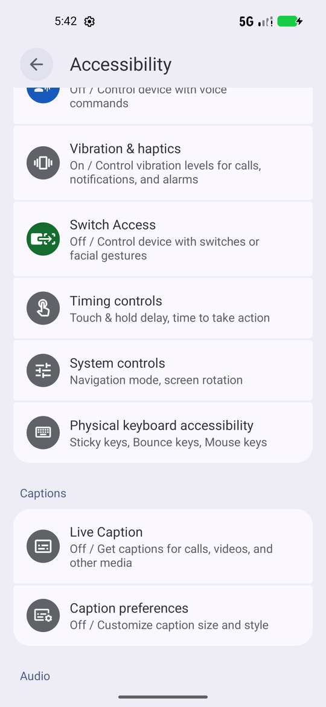
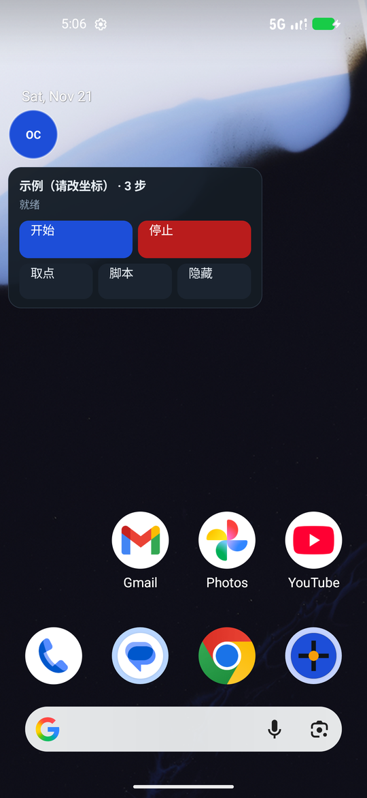
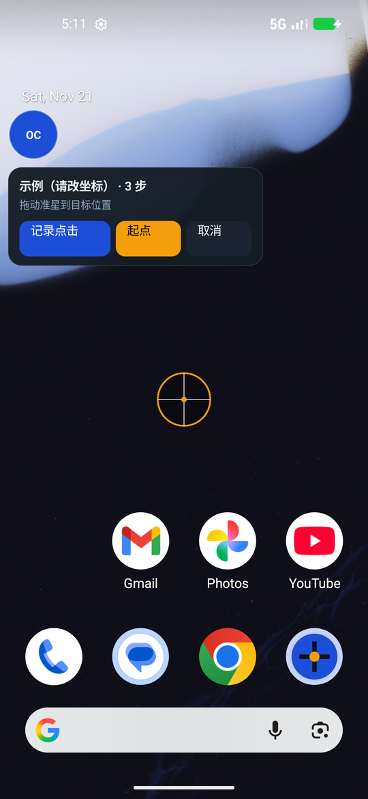

# outoclick · 安卓自动点击器

独立 Android App：在手机上预设固定坐标的点击序列，由无障碍服务回放。
**不需要电脑、不需要 ADB、不需要 Root。**

> 当前版本：MVP `0.1.0`（debug APK），已在 Pixel 5 模拟器 **Android 17 / API 37** 实测：安装、无障碍手势、悬浮球、取点、脚本运行、暂停/停止均通过。

## 截图

| 主界面 | 悬浮面板 | 准星取点 |
|---|---|---|
|  |  |  |

## 能做什么

- **悬浮准星取点**：打开目标 App，拖动十字准星到按钮上，点「记录」即生成一步坐标
- **脚本编排**：点击 / 长按 / 滑动 / 等待；每步可设延时、启用状态；脚本可循环 N 次
- **悬浮球控制**：开始 / 暂停 / 继续 / 停止；切到任何 App 都能操作
- **本机存储**：脚本是纯 JSON，支持复制、删除、剪贴板导入导出
- **前台服务**：运行状态常驻通知，避免被系统随手回收
- **深色界面**：手机端原生 View，无第三方 UI 框架

## 快速开始

### 直接安装 APK

```powershell
adb install -r android\app\build\outputs\apk\debug\app-debug.apk
```

或者把 APK 拷到手机上手动安装（需要允许「安装未知来源应用」）。

### 从源码构建

前置：

- JDK 17 或 21
- Android SDK：`platforms;android-36`、`build-tools;35.0.0+`
- Gradle 8.13（工程没有内置 wrapper）

```powershell
$env:JAVA_HOME='D:\JDKSS\Jdks\jdk-21.0.12.1+1'
$env:ANDROID_HOME='E:\AndroidSdk'
cd android
E:\gradle\gradle-8.13\bin\gradle.bat assembleDebug
```

`android/local.properties` 里的 `sdk.dir` 指向你的 SDK 目录（该文件已被 gitignore）。

产物：

```
android/app/build/outputs/apk/debug/app-debug.apk
```

## 使用流程

1. 打开 App，在「准备」卡片里依次开启：
   - **无障碍服务**：设置 → 无障碍 → 已下载的应用 → outoclick 点击执行器
   - **悬浮窗**：允许显示在其他应用上层
   - **通知**（Android 13+）：前台服务状态
2. 在「脚本」里新建，或直接用自带的示例脚本。
3. 点「启动悬浮窗」，App 会退到后台，屏幕上出现 **OC** 悬浮球。
4. 切到目标 App，点悬浮球 →「取点」：
   - 拖动准星到目标位置 →「记录点击」
   - 记录滑动：先把准星放到起点 →「起点」→ 移动到终点 →「终点」
5. 需要运行脚本时，点悬浮球 →「开始」。运行中可暂停、继续、停止。
6. 回到 App 可以微调每一步的坐标、时长、延时和循环次数。

## 脚本格式

每台手机本地保存为 `files/scripts/<id>.json`，也可以从 App 导出到剪贴板：

```json
{
  "schemaVersion": 1,
  "id": "a1b2c3d4e5",
  "name": "每日签到",
  "repeat": 1,
  "steps": [
    { "type": "TAP", "x": 540, "y": 1200, "durationMs": 60, "delayAfterMs": 800, "enabled": true },
    { "type": "LONG_PRESS", "x": 300, "y": 900, "durationMs": 800, "delayAfterMs": 300, "enabled": true },
    { "type": "SWIPE", "x": 540, "y": 1800, "x2": 540, "y2": 900, "durationMs": 300, "delayAfterMs": 300, "enabled": true },
    { "type": "WAIT", "durationMs": 1500, "delayAfterMs": 0, "enabled": true }
  ]
}
```

坐标是**屏幕物理像素**，原点在左上角。

## 权限与安全

| 权限 | 用途 | 是否读取内容 |
|---|---|---|
| 无障碍服务 | 通过 `dispatchGesture` 注入点击/滑动 | 否，`canRetrieveWindowContent=false` |
| 悬浮窗 | 悬浮球 + 准星取点 | 否 |
| 通知 | 前台服务状态 | 否 |

- 所有脚本与运行状态只存在本机，App 不联网。
- 无障碍服务只做手势注入，不读取屏幕内容，不上传任何数据。
- 停止是「不再派发下一步」，已经在执行的一次手势（通常 60–800ms）会自然结束，不会补点。

## 原理

```
MainActivity        脚本列表 / 步骤编辑 / 权限引导
OverlayService      悬浮球、面板、准星、前台通知
ClickAccessibilityService   dispatchGesture(TAP / LONG_PRESS / SWIPE)
Runner              协程顺序执行，循环、延时、暂停/停止
ScriptStore         filesDir/scripts/*.json
```

- 点击：`GestureDescription.StrokeDescription(path, 0, 60ms)`
- 长按：同点，时长 800ms
- 滑动：`moveTo → lineTo`，默认 300ms
- 等待：`delay(ms)`，可被暂停/停止打断
- 运行循环：`delayAfterMs` 在每步之后执行

## 已知限制

- **固定坐标**：目标 App 改版、换分辨率、改字体大小后需要重新取点。
- **仅竖屏**：暂不处理旋转后的坐标换算。
- **无图像识别**：不会「找按钮」，只按坐标点。
- **息屏/锁屏**：无障碍手势在锁屏状态下无法操作目标 App。
- **系统安全界面**：部分系统弹窗、安全键盘、支付类页面可能拒绝注入。
- **厂商保活**：MIUI / HyperOS / ColorOS 等可能杀后台，建议把 App 加入电池白名单。
- **反作弊风险**：游戏/平台可能检测自动化操作，账号风险由使用者承担。

## 项目结构

```
android/                    独立 Android 工程（主交付物）
  app/src/main/java/com/outoclick/app/
    MainActivity.kt         脚本列表 / 步骤编辑 / 权限引导
    OverlayService.kt       悬浮球、面板、准星、通知
    ClickAccessibilityService.kt  手势注入
    Runner.kt               顺序执行 / 循环 / 暂停停止
    Model.kt / Store.kt     脚本模型与本机 JSON 存储
app/                        早期的 Windows + ADB 原型（Python，非主交付物）
docs/PC-PROTOTYPE.md        PC 原型说明
docs/FEASIBILITY-REVIEW.md  规格可行性评审
SPEC.md                     PC 原型规格（v0.4），安卓版的约束可参考
```

## 开发

```powershell
# 只编译，不安装
cd android
E:\gradle\gradle-8.13\bin\gradle.bat assembleDebug

# 安装并看日志
adb install -r app\build\outputs\apk\debug\app-debug.apk
adb logcat -s outoclick AndroidRuntime
```

调试无障碍服务时，改完代码重新安装后需要在系统设置里**关闭再打开**一次无障碍服务，服务才会绑定新版本。

## 故障排查

| 现象 | 处理 |
|---|---|
| 悬浮球不出现 | 确认「显示在其他应用上层」已允许；在 App 里重新点「启动悬浮窗」 |
| 点「开始」没反应 | 无障碍服务未开启，或服务被系统杀掉；重新进设置开关一次 |
| 点击位置偏移 | 坐标是屏幕物理像素；用准星重新取点，注意状态栏/手势导航区域 |
| 运行一会儿就停 | 厂商省电策略杀掉服务；加入电池白名单，保持前台通知 |
| 取点面板挡住目标 | 拖动悬浮球换个位置，或点「隐藏」再点球展开 |
| 安装失败 | 确认允许未知来源；或 `adb install -r` 覆盖安装 |
| 无障碍开关是灰的 / 提示受限 | Android 13+ 侧载应用需在「应用信息 → outoclick → 允许受限设置」后再开启无障碍 |

## 下一步

- 录制模式（记录真实手指轨迹生成步骤）
- 脚本分组循环 / 条件步骤
- 导入导出文件（现在走剪贴板）
- 横屏与旋转坐标换算
- 运行日志与失败截图（需要 MediaProjection）
- 计划任务（每天定时执行）
