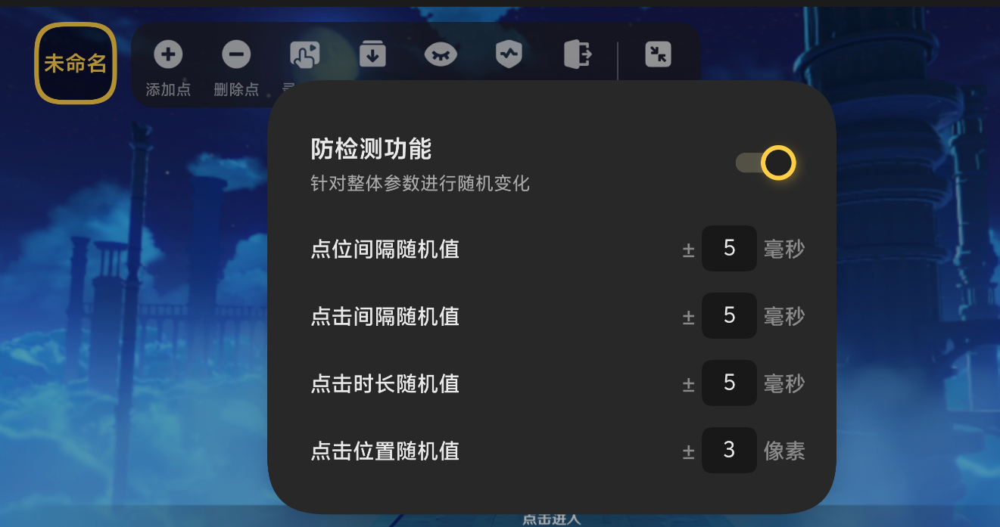

使用体验

## 图 1｜点击器功能实验室（能力入口面板）

产品视角看，这是一块以「实验室内嵌面板」形态出现的能力入口：暗色半透明大圆角浮层，右上角单点关闭，左上角「‹ + 点击器功能实验室」标明这是宿主应用内的二级页面，可随时退出回到原界面。信息按四层递进排布：

1. **风险提示条**——喇叭图标 + 「部分游戏存在封号风险」+「更多 ›」。把合规风险放在首屏而非折叠进用户协议，属于「先告知再使用」的典型处理；「更多」给了展开细节的出口，不打断主流程。
2. **新手引导 Banner**——「点击器新手指南 / 查看详情」，背景是手势点击示意并带 1、2 步骤编号，用图片替代文字教程，降低首次上手成本；Banner 高度占位大，说明拉新/激活是此页首要目标。
3. **方案管理区**——「我的方案（1/10）」以分数暴露配额（已用 1 / 上限 10），让容量限制提前可见；右侧「方案广场」用强调色做成外链入口，等于把单机工具升级成方案可分发、可复用的社区生态，这是留存与 UGC 的关键设计。
4. **会话级快捷设置**——「自动跳过」一行同时给出撤销、删除、开关三个操作，摆在同一行说明它们是高频、轻量的临时调整，不需要进二级页。

底部双 CTA 结构清晰：「创建方案」为黄色实心主按钮，「导入方案」为深色次级按钮。默认引导从零创建，同时用导入兼容已有脚本的存量用户，符合「新用户走主路径、老用户走迁移路径」的分流思路。整页只用黄色一种强调色，层级靠明度与留白区分，符合工具类产品的克制风格。

## 图 2｜方案编辑画布与顶部工具栏

画面是「游戏实景 + 透明编辑层」的叠加式编辑器，属于所见即所得（WYSIWYG）路线：用户直接在真实界面上圈选点击位置，而不是在抽象坐标系里填数值，配置成本从「理解参数」降为「指一下」。对这类操作工具而言，这是最省认知的交互模型，也让「这个点到底点到哪」零歧义。

- **左上角「未命名」**：黄色描边的胶囊标签，用描边而非纯文字表达「可点击、待填写」，把命名这个必做动作前置成视觉焦点。
- **顶部胶囊工具栏**：按语义分组。「添加点 / 删除点 / 录方案」是内容编辑动作；竖分隔线之后「保存 / 隐藏 / 防检测 / 退出方案」是会话与安全动作；最右「收起」把整条工具栏折叠，避免长时间编辑时遮挡目标界面——这在需要看清画面细节的场景里是必要设计。
- **画布上的编号点**：1、2、3 三个圆形序号直接贴在游戏画面上表示执行顺序；「2」带黄色高亮环，表示当前选中/待配置的点，其余为灰色未激活态。用「编号 + 高亮」双重编码同时表达时序和焦点，无需图例即可读懂，这是低成本高信息量的做法。

工具栏只保留图标 + 四字以内文案，主色仅黄色一种，视觉上不与游戏画面争抢注意力；功能密度高但排布线性、可预测，属于成熟工具型产品的常见范式。需要注意「防检测」被放进一级工具栏，说明它被视为核心卖点而非高级设置。

## 图 3｜单点设置弹窗（基础参数）

居中深色模态框，遮罩压暗画布，注意力完全收敛到表单上。右上角单独放一个垃圾桶图标承载「删除该点」这一破坏性操作——位置远离底部主按钮，且不是文字按钮，避免与「完成」并排造成误触，是破坏性操作隔离的常规做法。

标题下方一句「1000毫秒为1秒，数值越小，速度越快」把单位换算和方向性（越大越慢）直接写在表单里，属于前置答疑：这类工具的参数很容易被误解，把解释放在输入处能显著降低填错率和客服量。

表单部分采用「开关 + 数值」混合控件，并体现了条件依赖关系：

- **设置为滑动点**（开关，默认关）：副标题「设置后，可执行滑动操作」。用一个开关把「点击」扩展为「滑动」，而不是并列出第二种点位类型，保持了心智模型的一致性。
- **点击次数**（默认 1 次）：副标题「点击次数超过1次才可设置间隔」，直接把联动规则文字化，让用户在被禁用之前就知道原因。
- **点击间隔**（1000 毫秒）：当前呈灰色不可编辑态，与上一条说明形成因果闭环。用禁用态表达依赖，比点击后弹错误提示更友好，是「渐进式披露」的正确用法。

底部「取消」灰色次级与「完成」黄色主按钮并排，唯一实心强调色落在完成上，行动路径没有歧义；取消左、完成右也符合中文用户的阅读与拇指习惯。默认值全部取保守值（1 次点击、1 秒间隔），保证新用户不改任何参数也能跑通。

## 图 4｜单点设置弹窗（进阶参数与运行环境）

同一弹窗向下滚动后的参数区，完整暴露了四个可调维度：

| 参数 | 默认值 | 说明文案 |
|---|---|---|
| 点击次数 | 1 次 | 点击次数超过 1 次才可设置间隔 |
| 点击间隔 | 1000 毫秒（当前禁用） | 重复点击时的间隔时间 |
| 点击时长 | 75 毫秒 | 按下到抬起的触屏时间 |
| 点位间隔 | 1000 毫秒 | 距离上一点位的点击时间间隔 |

产品上最值得注意的两点：一是把「点击间隔」（同一点位重复点击之间）与「点位间隔」（不同点位之间）明确拆成两个字段，并各自配一行副标题解释，说明目标用户是需要精细调节奏的进阶玩家，而不是只求「能自动点」的小白；二是「点击时长」默认 75 毫秒，刻意贴近真人按压时长，是把拟人化参数做成了开箱默认值，而不是丢给用户自己猜——默认值的选择本身就是产品判断。

弹窗底部露出的系统水印「NRELAndroid7.2.0_R49530578_S49684090_D49419538」表明该应用运行在 Android 7.2 的云手机/模拟器镜像内。这解释了产品形态：脚本依赖虚拟设备承载，因此「隐藏」「防检测」这类与运行环境强相关的功能才会成为一级能力。同时也意味着性能与兼容性基线要按低版本系统来设计。

按钮区与上一屏保持一致（取消 / 完成），滚动后仍固定可见，长表单里保持操作可达，避免用户滚到底部找不到确认键。

## 图 5｜防检测功能面板

与编辑画布同屏的深色参数面板，标题「防检测功能」配副标题「针对整体参数进行随机变化」——这句副标题把能力边界说得很准：它不改变操作本身，只对已有参数做随机抖动，用户不会误以为开启后行为会变。

层级设计是「一个总开关 + 四组细分参数」：右上角总开关带黄色光环，当前为开启态，小白可一键生效；四组参数各自可调，满足进阶用户的微调需求。四行统一使用「± 数值 + 单位」的书写格式：

- 点位间隔随机值 ± 5 毫秒
- 点击间隔随机值 ± 5 毫秒
- 点击时长随机值 ± 5 毫秒
- 点击位置随机值 ± 3 像素

单位区分得很干净：时间类统一用毫秒，空间类用像素，用户不需要理解换算。默认抖动幅度都取得很小（5 毫秒 / 3 像素）——这是「让轨迹不像机器」与「不让点击落到目标热区之外」之间的保守折中，3 像素偏移通常仍落在按钮可点范围内，可用性优先于隐蔽性，这个默认值取舍是合理的。

从产品与合规角度看需要点明：该能力直接对抗目标应用的自动化检测机制，与图 1 首屏「部分游戏存在封号风险」的提示互为呼应，属于高风险功能。产品侧宜保证三点：风险提示常驻且不可关闭、总开关默认关闭或至少每次显式确认、以及在用户协议中明确使用范围与责任归属。
