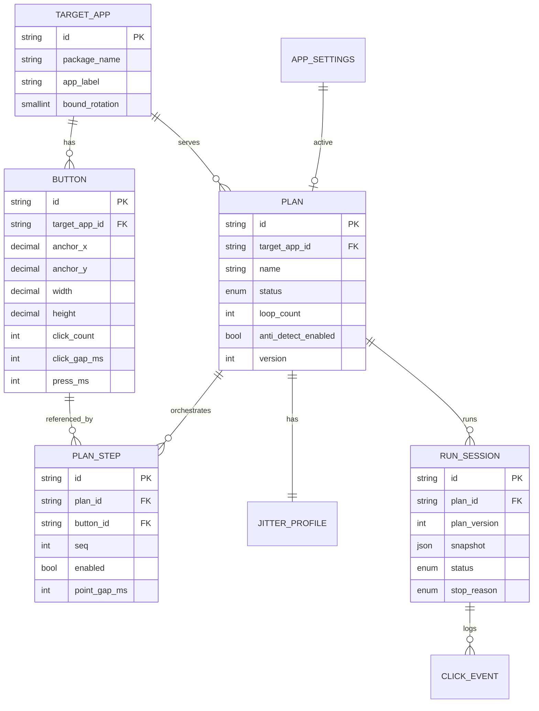
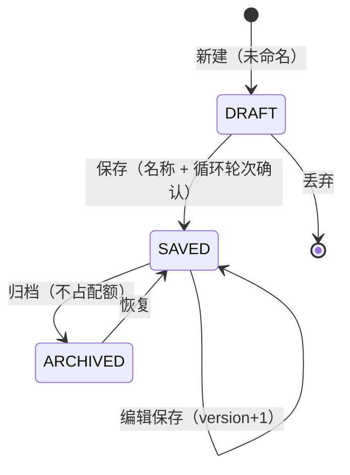
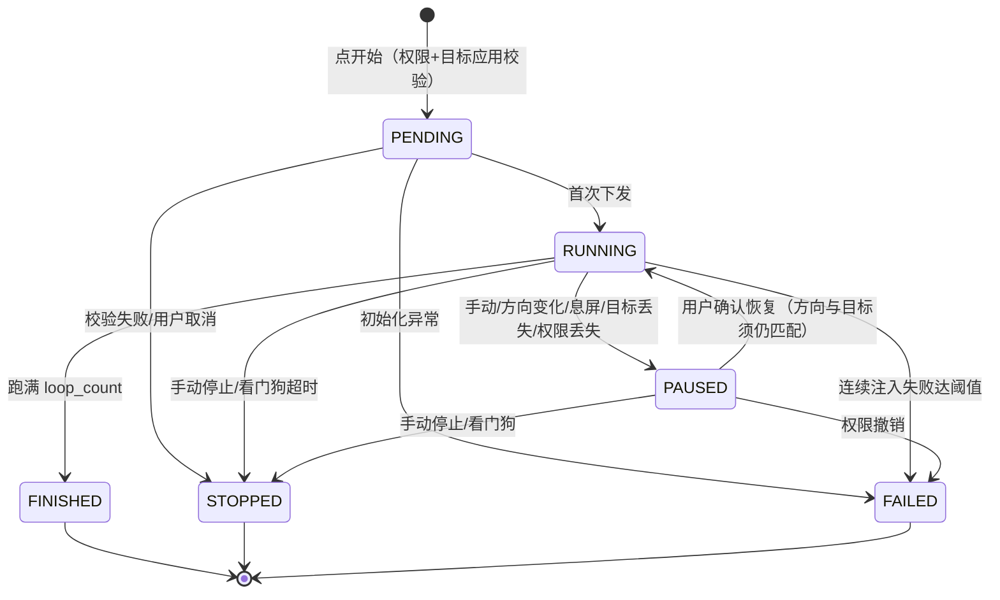

# 数据实体建模分析（v4 · 决策落地版）

> **v3 → v4 变更**：依据《规格审查报告》与产品决策，6 个 P0 全部收口；实体结构由「方案持有按钮」改为「**按钮库 + 方案编排**」；时间轴语义定死；急停、系统矩阵、MVP 范围均给出决定。
> 本文档不再保留待定项，剩余不确定性全部收敛为「必须真机验证的 Spike」（见 §12）。

---

## 0. 决策台账

| # | 事项 | 决定 | 影响范围 |
|---|---|---|---|
| D1 | `auto_skip` 是什么 | **「把该方案切换为当前方案」**，不是广告跳过 | 删除 `Plan.auto_skip`，改为 `AppSettings.active_plan_id` 全局单选；UI 文案建议改成「设为当前方案」 |
| D2 | 目标应用怎么记 | 存 **`package_name`**（不存安装路径）；**自动识别 + 一次确认**——监听前台包名，检测到非系统应用且方案未绑定时提示 | 新增 `TargetApp` 实体；`Plan.target_app_id` 必填 |
| D3 | 按钮与方案的关系 | **按钮独立成库，方案只做编排** | 拆分 `Button` 与 `PlanStep`；`seq`、`点位间隔`、`启用` 迁到编排层 |
| D4 | 急停载体 | **常驻悬浮球是唯一入口**，工具条显隐由它控制，通知栏只作辅助 | 新增 §8；悬浮球不得被隐藏 |
| D5 | 系统矩阵 | minSdk 24 / targetSdk 34；验证 7.1 + 10 + 13 + 14；v1 **侧载优先，不上 Play** | 见 §9 |
| D6 | MVP 范围 | 砍到「一个应用、一组按钮、跑 N 轮、随时能停」 | 见 §10 |
| D7 | 点位间隔默认值 | **1000ms**，用户可自由设定（0~60000） | 与截图一致；`PlanStep.point_gap_ms` 默认 1000 |
| D8 | 删除按钮语义 | **彻底删除**；被 N 个方案引用时二次确认，确认后级联移除对应步骤并重排 `seq` | 修改 C14 |

---

## 1. 为什么改成「按钮库 + 编排」

你的原话：**「本质上是起几个按钮，然后我们的方案对这些按钮做编排」**。这句话直接决定了实体边界——按钮是**被编排的对象**，不是方案的私有属性。

| 属性 | 归属 | 为什么 |
|---|---|---|
| 位置、大小 | `Button` | 描述「点哪里、多大范围」，与哪个方案无关 |
| 点击次数、点击间隔、点击时长 | `Button` | 描述「怎么点」，是同一次动作的物理特征 |
| 执行顺序、点位间隔、是否启用 | `PlanStep` | 描述「先点谁后点谁、隔多久」，只对某个方案成立 |
| 循环轮次、防检测、目标应用 | `Plan` | 方案级策略 |

改完之后有两个直接收益：

1. **同一个按钮可以在一份方案里出现两次**（例如「领取 → 返回 → 再领取」用同一个坐标），老模型只能复制出两个点，改位置要改两处。
2. **改按钮位置会自动作用于所有引用它的方案**，不用逐个方案改。

代价也要认：**删除按钮会牵连多个方案**。所以 C14 要求删除前检查引用数，被引用时只允许「从编排中移除」，不允许直接删按钮。

> UI 上的对应关系：画布的「添加点」= 在按钮库新建按钮 + 插入一个编排步骤；「删除点」看语境——只从流程里拿掉是删步骤，要彻底删除得去按钮库。v1 不单独做按钮库页面，删除时弹一次选择即可。

---

## 2. 实体清单

| # | 实体 | 角色 | 关系 | v1 |
|---|---|---|---|---|
| E1 | `TargetApp` 目标应用 | 被操作对象 | 1:N 按钮 / 方案 | ✅ |
| E2 | `Button` 按钮 | 物理可点目标 | N:1 应用；被编排引用 | ✅ |
| E3 | `Plan` 方案 | 编排容器 | 1:N 步骤 | ✅ |
| E4 | `PlanStep` 编排步骤 | 引用 + 顺序 + 间隔 | N:1 方案 / N:1 按钮 | ✅ |
| E5 | `JitterProfile` 防检测参数 | 值对象 | 内嵌 Plan | ✅ |
| E6 | `RunSession` 运行实例 | 一次执行 | 引用方案快照 | ✅ |
| E7 | `AppSettings` 全局设置 | 单行配置 | 记录当前方案 | ✅ |
| E8 | `ClickEvent` 执行事件 | 埋点 | 按会话聚合 | v1.5 |

---

## 3. ER 图



---

## 4. 字段字典

### 4.1 `TargetApp` 目标应用

| 字段 | 类型 | 说明 | 约束 |
|---|---|---|---|
| `id` | uuid | 主键 | — |
| `package_name` | varchar(120) | **包名**，如 `com.xxx.game` | 唯一、非空 |
| `app_label` | varchar(50) | 展示名（绑定时从系统取） | 非空 |
| `icon_ref` | varchar(200)? | 图标缓存路径 | 可空 |
| `bound_rotation` | smallint | 绑定时屏幕方向（0/90/180/270） | 默认 0 |
| `bound_display_w/h` | int | 绑定时显示区域尺寸 | 非空 |
| `first_bound_at` / `last_run_at` | datetime | — | — |

> **为什么存包名而不是「应用路径」**：安装路径会随更新、重装、分身（多开）而变，包名才是稳定标识。同一个包在分身里可能属于不同 `userId`，v1 不区分，已知限制。

### 4.2 `Button` 按钮

| 字段 | 类型 | 说明 | 约束/默认 |
|---|---|---|---|
| `id` | uuid | 主键 | — |
| `target_app_id` | uuid | 归属应用 | FK |
| `label` | varchar(20)? | 备注，如「领取」 | 可空 |
| `anchor_x` / `anchor_y` | decimal(6,5) | 中心点，比例 0~1 | 必填，**允许贴边** |
| `width` / `height` | decimal(6,5) | 热区，比例 0~1 | 默认 `0.12 × 0.05`，0.01~1 |
| `click_count` | int | 点击次数 | 默认 1，1..50 |
| `click_gap_ms` | int | **点击间隔**：上一次抬起 → 下一次按下 | 默认 120，0..60000；`click_count=1` 时无效 |
| `press_ms` | int | **点击时长**：按下 → 抬起 | 默认 75，10..500 |

> 按钮不设软删：删除即物理删除，引用清理见 C14。
> 注意：`seq`、`point_gap_ms`、`enabled` **不在按钮上**，它们属于编排（§4.4）。

### 4.3 `Plan` 方案

| 字段 | 类型 | 说明 | 约束/默认 |
|---|---|---|---|
| `id` | uuid | 主键 | — |
| `target_app_id` | uuid | 服务的目标应用 | 必填 |
| `name` | varchar(20) | 方案名 | 默认「未命名」，允许重名 |
| `status` | enum | **仅** `DRAFT` / `SAVED` / `ARCHIVED` | 运行态不在这里（见 §6） |
| `loop_count` | int | 循环轮次，保存时填写 | 默认 1，1..99 |
| `anti_detect_enabled` | bool | 防检测总开关 | 默认 `false` |
| `jitter_delay_ms` | int | 点位间隔抖动 ± | 默认 5，0..200 |
| `jitter_gap_ms` | int | 点击间隔抖动 ± | 默认 5，0..200 |
| `jitter_press_ms` | int | 点击时长抖动 ± | 默认 5，0..200 |
| `jitter_pos_px` | int | 点击位置抖动 ±（像素） | 默认 3，≤ min(w,h)/2 |
| `version` | int | 内容版本，保存 +1 | — |
| `created_at` / `updated_at` / `last_run_at` | datetime | — | — |
| `deleted` | bool | 软删 | 默认 `false` |

### 4.4 `PlanStep` 编排步骤

| 字段 | 类型 | 说明 | 约束/默认 |
|---|---|---|---|
| `id` | uuid | 主键 | — |
| `plan_id` | uuid | 所属方案 | FK，级联删 |
| `button_id` | uuid | 引用的按钮 | FK，**禁止级联删** |
| `seq` | int | 执行顺序 = 画布上的 1/2/3 | 唯一 `(plan_id, seq)`，1..N 连续 |
| `enabled` | bool | 本步是否参与执行 | 默认 `true` |
| `point_gap_ms` | int | **点位间隔**：本步最后一次抬起 → 下一步第一次按下；**跨轮同样生效** | 默认 1000，0..60000 |

> 允许同一 `(plan_id, button_id)` 出现多次，这是「同一坐标在流程里点两回」的正常需求，不视为重复（C15）。

### 4.5 `AppSettings` 全局设置（单行）

| 字段 | 类型 | 说明 |
|---|---|---|
| `active_plan_id` | uuid? | **当前方案**（D1 落点）。为空表示未选；全局唯一 |
| `default_jitter_*` | int | 新建方案的防检测默认值 |
| `schema_version` | int | 本地数据结构版本，用于升级迁移 |

> 「切换当前方案」是**单选**语义：设置 A 为当前方案时，B 自动取消。所以它本质是一组单选按钮，UI 用开关表达是取巧——建议图 1 那个开关旁加一句「当前方案」，或者直接改成单选点。

### 4.6 `RunSession` 运行实例

| 字段 | 类型 | 说明 |
|---|---|---|
| `id` / `plan_id` / `plan_version` | — | 会话标识与来源版本 |
| `target_app_id` / `target_package` | — | 运行时冻结的目标应用 |
| `snapshot` | json | 见下方清单；含 `schema_version`、`engine_version` |
| `status` | enum | `PENDING` / `RUNNING` / `PAUSED` / `FINISHED` / `STOPPED` / `FAILED` |
| `paused_reason` | enum? | `USER` / `ROTATION` / `SCREEN_OFF` / `TARGET_MISMATCH` / `PERMISSION_LOST` |
| `stop_reason` | enum? | `COMPLETE` / `USER` / `KILLED` / `TIMEOUT` / `ERROR` / `TARGET_MISMATCH` / `PERMISSION_LOST` |
| `current_step_seq` / `loop_index` | int | 进度，用于断点续跑与悬浮窗显示 |
| `last_progress_at` | bigint | **`elapsedRealtime`**，看门狗依据（不用墙钟） |
| `foreground_package` | varchar(120) | 最后一次见到的前台包名，排障用 |
| `display_w/h` / `rotation` | int | 运行时屏幕状态 |
| `error_code` | varchar(40)? | `DISPATCH_REJECTED` / `USER_CANCELLED` / `NODE_GONE` 等 |
| `started_at` / `ended_at` | datetime | 展示用 |

**快照必须包含**：`schema_version`、engine 版本、方案名、`target_package`、`loop_count`、防检测四值、按 `seq` 排好的步骤、每个步骤引用的按钮物理参数（位置/大小/次数/gap/press）、`point_gap`、运行时 `display_w/h` + `rotation`。

> 快照是**深拷贝**：按钮在会话开始后被修改，本次运行也不受影响。

---

## 5. 时间轴（语义定死，这是最容易写错的地方）

### 5.1 定义（gap 语义）

```
第 i 次按下         t_i
第 i 次抬起         t_i + press_i
下一次按下          t_{i+1} = t_i + press_i + click_gap      (i = 1..n-1)
本步结束            t_n + press_n
下一步第一次按下    本步结束 + point_gap
```

- `click_gap_ms`：**抬起 → 下一次按下**的空档，不是「按下→按下」的周期；
- `point_gap_ms`：本步最后一次**抬起** → 下一步第一次**按下**；
- **跨轮也生效**：第 N 轮最后一步的 `point_gap` 就是轮与轮之间的间隔，不额外引入 `loop_gap`；
- 只有**最后一轮的最后一步**不执行 `point_gap`，跑完立即结束。

### 5.2 公式

```
单步动作时长 = click_count × press + (click_count − 1) × click_gap
单轮时长     = Σ 每个 enabled 步骤 (动作时长 + point_gap)
预估总时长   = loop_count × 单轮时长 − 最后一个 point_gap
```

### 5.3 校验例（3 个按钮、各点 1 次、press=75、gap=1000）

```
单轮 = 3 × (75 + 1000) = 3225 ms
10 轮总时长 = 10 × 3225 − 1000 = 31250 ms ≈ 31.3 s
```

> v3 文档里写的「2.4 s」是错的（漏掉按压时间），以本表为准。

### 5.4 边界

| 场景 | 结果 |
|---|---|
| `click_count = 1` | `click_gap` 不参与计算，UI 置灰 |
| `point_gap = 0` | 连续点击无停顿，保存时提示「过快可能导致目标应用不响应」 |
| `loop_count = 1` | 末步 `point_gap` 不执行 |
| 步骤 `enabled = false` | 完全跳过，不占时间（公式里也排除） |
| 抖动开启 | 预估按基准值显示为「约 X」，实测会浮动 |

---

## 6. 状态机与不变量

### 6.1 方案状态（只管内容，不管运行）



> **`RUNNING` 已从 `Plan.status` 移除**。运行态的唯一来源是 `RunSession`，避免两个写者漂移（P0-3）。界面上方案卡片的「运行中」徽标由 `active_session` 派生，不落库。

### 6.2 会话状态



### 6.3 不变量

| 编号 | 约束 | 备注 |
|---|---|---|
| **C1** | 方案数 ≤ 10（`deleted=false` 且非 `ARCHIVED`） | 归档不占配额 |
| **C2** | 每方案 `1..30` 个步骤，`seq` 为 `1..N` 连续唯一 | 重排用事务 + 临时偏移，避免交换冲突 |
| **C3** | `click_count = 1` 时 `click_gap` 不参与计算且 UI 禁用 | — |
| **C4** | `anchor` 中心 ∈ `[0,1]`；热区与屏幕求交，**贴边只提示不拒绝** | 修正 v3 一刀切 |
| **C5** | `jitter_pos_px ≤ min(w_px, h_px)/2`，且**运行时再 clamp 一次** | 防屏幕变小后越界 |
| **C6** | 全局最多 1 个**非终态**会话（`PENDING`/`RUNNING`/`PAUSED`） | 修正只锁 `RUNNING` 的漏洞 |
| **C7** | 删除方案：先停会话 → 软删方案 → 会话保留并引用快照；**按钮不受影响** | — |
| **C8** | 运行方向/显示尺寸与 `Button.bound_rotation` 不一致 → 拒绝启动；运行中变化 → `PAUSED(ROTATION)`，**恢复需用户确认** | 不自动恢复 |
| **C9** | `loop_count ∈ [1,99]`，保存时必填；为 1 时显示「跑一遍就结束」 | — |
| **C10** | 保存时展示预估时长；超 30 分钟二次确认；预估**只用于展示**，看门狗另算 | 修正 v3 |
| **C11** | 会话只读快照；改方案只影响下一次 | — |
| **C12** | 保存/启动要求**至少 1 个 enabled 步骤，且其按钮未被删** | 空方案直接禁止 |
| **C13** | 前台包名 ≠ `target_package` → `PAUSED(TARGET_MISMATCH)`；黑名单应用硬阻止 | 黑名单见 §7.3 |
| **C14** | 删除按钮为**彻底删除**；若被 N 个方案引用，先提示影响范围并二次确认，确认后级联移除这些方案中的对应步骤并重排 `seq` | 不留坏数据 |
| **C15** | 同一按钮可在同一方案被多个步骤引用，合法 | — |
| **C16** | `AppSettings.active_plan_id` 全局唯一（单选） | D1 |

---

## 7. 目标应用：怎么绑定、怎么防误点

### 7.1 先纠正一个理解

**悬浮窗没有「只对某个应用悬浮」的系统能力**。`SYSTEM_ALERT_WINDOW` 是全局的，挂上去就覆盖所有界面。

所谓「指定可悬浮的应用」，实现方式是：**监听前台包名，命中目标应用才显示编辑工具条**；不命中就隐藏工具条。这不是系统限制，是自己做的显隐逻辑。

⚠️ 但**悬浮球必须例外，永远显示**。否则「切到别的应用就藏起来」+「通知被划掉」= 又回到关不掉。

### 7.2 包名怎么来（三种方式，v1 用第一种）

| 方式 | 做法 | 优点 | 缺点 |
|---|---|---|---|
| **A. 自动识别 + 一次确认（采用）** | 监听 `TYPE_WINDOW_STATE_CHANGED`，检测到用户切到非白名单应用且方案未绑定时，提示「检测到你正在使用「XXX」，设为目标应用？」；包名取 `AccessibilityEvent.getPackageName()` | 零权限、零列表、用户不用手填 | 仍需用户先把目标 App 打开一次（物理上限）；同一次进入只提示一次 |
| B. 从已安装列表选 | `PackageManager` 查询，需 `<queries>` 声明（Android 11+） | 一次可见全部应用 | 列表长、难找；`QUERY_ALL_PACKAGES` 上架敏感；分身不区分 |
| C. 手填包名 | 输入框 | 最省事 | 体验差，易错 |

绑定后同时从 `PackageManager` 取 `app_label` 与图标做展示，避免只显示包名。

### 7.3 防误点是三道闸

1. **启动前**：校验当前前台包名 == `target_package`，不符直接不允许开始并提示「请先打开 XXX」；
2. **运行中**：监听 `TYPE_WINDOW_STATE_CHANGED`，包名变化立即 `PAUSED(TARGET_MISMATCH)`，不自动恢复；
3. **硬阻止名单**：系统设置、安装器、权限控制器、桌面、SystemUI 出现时无条件停止，即使被错配成目标应用也不允许继续。名单内置，不可由用户关闭。

### 7.4 已知限制

- 分身/多开：同包名不同 `userId`，v1 无法区分；
- 目标应用内嵌 WebView/H5：包名不变，仍能正常点；
- 系统弹窗（如权限确认）通常属于 `com.android.permissioncontroller`，会被第 3 道闸拦下。

---

## 8. 急停与后台生命周期

### 8.1 四层急停，按可靠性排序

| 层 | 手段 | 可靠性 | 说明 |
|---|---|---|---|
| 1 | **常驻悬浮球** | 硬保障 | 半透明小圆点，可拖动、可吸附边缘；**单击=停止**；展开菜单里可「显示/隐藏工具条」。任何操作都不得隐藏它 |
| 2 | 通知栏「停止」 | 辅助 | 被划掉时用 `deleteIntent` 重新发出；通知权限被拒时不依赖它 |
| 3 | 无障碍快捷方式 / 音量键 | 可选 | 用户可开；不默认开，避免误触 |
| 4 | 无进度看门狗 | 兜底 | 见 §8.2 |

「隐藏」收纳进**悬浮球菜单**，只隐藏编辑工具条与画布标记，悬浮球常驻——这是 D4 的落地含义。

### 8.2 无进度看门狗（替代 v3 的总时长阈值）

```
最大允许间隔 = max( 3 × 当前步骤预期间隔, 30s )
当前步骤预期间隔 = point_gap + click_count × press + (click_count − 1) × click_gap + 抖动上限
超过「最大允许间隔」无任何进度更新 → STOPPED(TIMEOUT)
```

- 用 `elapsedRealtime`，不受系统改时间影响；
- `PAUSED` 期间冻结，恢复后重新计时（修正 v3 把暂停算进超时的错误）；
- 每次点击成功都刷新 `last_progress_at`。

### 8.3 生命周期（v1 就做，不推到 v1.5）

- 会话状态独立持久化，界面只是视图；
- **启动对账**：发现非终态会话但无存活服务/心跳 → 标 `STOPPED(KILLED)`，清掉残留悬浮层；
- **不主动自启**：不使用 `START_STICKY`，不注册 `BOOT_COMPLETED` 自动恢复；被系统杀掉后弹通知「方案已中断」；
- 每次进入前台重新检查四项权限，缺失则阻止启动并给引导。

---

## 9. 系统矩阵（D5）

| 项 | 决定 | 理由 |
|---|---|---|
| `minSdk` | 24（Android 7.0） | `dispatchGesture` 的最低要求 |
| `targetSdk` / `compileSdk` | 34 | 覆盖当前主流机型，避免兼容告警 |
| 前台服务类型 | `specialUse` + 说明文案 | targetSdk 34 起必须声明 |
| 通知权限 | Android 13+ 运行时申请；拒绝则降级到悬浮球，并在启动时明确提示 | 通知不可作为唯一停止路径 |
| 分发方式 | v1 **侧载 / 云手机预装**，不上 Google Play | 无障碍自动化在 Play 有专门政策与审核风险 |
| 验证矩阵 | Android 7.1 云手机（主战场）、Android 10、Android 13、Android 14 | 覆盖 `dispatchGesture` 早期实现与现代权限模型两端 |
| 无障碍引导 | Android 13+ 侧载需先「允许受限设置」，做图文引导 | 否则用户开不了服务 |

---

## 10. MVP 范围（D6）

### 10.1 做

- 绑定目标应用（方式 A）、显示应用名与图标；
- 按钮：新建、改位置/大小、删除；点击次数/间隔/时长；
- 编排：插入步骤、拖拽排序、单步启用/禁用、点位间隔；
- 方案：命名、保存时确认循环轮次、预估时长展示、10 个配额；
- 运行：开始 / 暂停 / 继续 / 停止；常驻悬浮球；无进度看门狗；
- 保护：目标应用校验、黑名单、方向变化暂停、息屏锁屏暂停；
- 持久化 + 启动对账 + 最小会话日志（`last_progress_at`、`error_code`、`stop_reason`）。

### 10.2 不做（明确砍掉）

| 不做 | 备注 |
|---|---|
| 方案广场 | 无规划 |
| 滑动点位 | v2 再评估，模型留了扩展位 |
| 录方案 | 缺 `source=RECORDED` 与端到端流程，UI 入口先隐藏 |
| 撤销 | 交互成本高，先做「删除前确认」 |
| 三套参数预设 | 默认值直接写死一套即可 |
| 导入 / 导出方案 | 少了它 v1 仍闭环，也免掉一批导入校验 |
| 跨设备 / 云手机管理 | 不做设备表 |
| 防检测配置面板 | **随机化引擎保留**，固定默认值（±5ms / ±3px），不暴露 UI |
| `ClickEvent` 明细表 | 先只留会话级日志 |

---

## 11. 与审查报告的对应

| P0 | 状态 | 落点 |
|---|---|---|
| P0-1 `auto_skip` 语义 | ✅ 关闭 | D1 → `AppSettings.active_plan_id` |
| P0-2 缺目标应用 | ✅ 关闭 | `TargetApp` + `Plan.target_app_id` + §7 三道闸 |
| P0-3 状态双写 / 状态机不闭环 | ✅ 关闭 | `Plan.status` 移除 `RUNNING`；C6 改为非终态唯一；对账提到 v1 |
| P0-4 急停不可靠 | ✅ 关闭 | §8.1 常驻悬浮球为硬保障 |
| P0-5 空方案无约束 | ✅ 关闭 | C12 |
| P0-6 时间轴不一致 | ✅ 关闭 | §5 定死 gap 语义 + 修正示例 |

P1 中已一并吸收：贴边按钮放开（C4）、抖动双重 clamp（C5）、方向不一致拒绝（C8）、看门狗改无进度（§8.2）、快照加 `schema_version`（§4.6）、可观测字段补齐（§4.6）、状态机补全（§6.2）。**未吸收**：导入导出校验（v1 不做导入）、`specialUse` 审核说明（不上 Play）、`seq` 改用 `sort_key`（v1 数据量小，事务重排足够）。

---

## 12. 开工前必须验证（Spike）

| # | 验证 | 通过标准 | 不通过怎么办 |
|---|---|---|---|
| S1 | 手势时序：`press=75` 实测、`gap=120` 连点、50 次连点是否互相取消 | 误差 ±15ms；连点不丢 | 提高最小间隔 / 降次数上限 |
| S2 | 坐标：`dispatchGesture` 坐标系与 `WindowMetrics` 是否一致；旋转后同一比例是否仍命中 | 中心误差 ≤1px | 按方向独立存坐标 |
| S3 | 急停：拒通知权限、划掉通知、点隐藏、撤销悬浮窗权限 | 任一情况 1 次操作 ≤2s 停止 | 悬浮球改为系统级常驻条 |
| S4 | 生命周期：`am force-stop`、划最近任务、Task Manager 停止 | 无残留非终态会话 | 只保留启动对账兜底 |
| S5 | 目标守卫：切应用 / 按 Home / 拉权限弹窗 | ≤200ms 暂停 | 每次点击前同步查一次前台包名 |
| S6 | 息屏 / 锁屏 / Doze | 立即暂停、无点击落到锁屏 | keep-screen-on + 运行前引导 |

S1–S3 不通过就回头改规格，不建议先写 UI。

---

## 13. 未来扩展（都是加法）

| 需求 | 加什么 | 老数据 |
|---|---|---|
| 滑动点位 | `Button.kind`（默认 `TAP`）+ `swipe_dx/dy/duration` | 纯新增列 |
| 无限循环 | `Plan.loop_mode` | 默认 `ONCE`，复用 `loop_count` |
| 方案广场 | `MarketPlan` + `Plan.market_ref` | 纯新增 |
| 跨设备 | `Device` + 坐标换算 | 已按比例存，只需补换算 |
| 录方案 | `Plan.source = RECORDED` + 录制器 | 纯新增枚举值 |
| 按钮库页面 | 复用 `Button` 表，只加 UI | 无需改表 |
